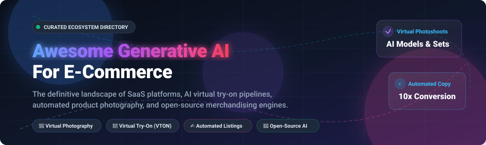

  

<h1 align="center">🛒 Awesome Generative AI For E-Commerce 🤖</h1>

  <strong>Curated directory of SaaS solutions, open-source AI pipelines, virtual try-on models, and merchandising automation tools.</strong>

  <a href="#-sector-overview--market-dynamics">📈 Sector Overview</a> •
  <a href="#-saas-platforms">☁️ SaaS Platforms</a> •
  <a href="#-open-source-projects">💻 Open-Source Projects</a> •
  <a href="#-key-capabilities--use-cases">🎯 Use Cases</a> •
  <a href="#-how-to-contribute">🤝 Contributing</a> •
  <a href="#-support--sponsor">💖 Support</a> •
  <a href="#-star-history">⭐ Star History</a> •
  <a href="#-disclaimer">⚖️ Disclaimer</a>

  
  
  
  
  
  
  

---

## 📈 Sector Overview & Market Dynamics

The global market for Generative AI in E-commerce is estimated at **$0.7B–$1.2B** (scaling past **$3.9B+ by 2032** at a ~27% CAGR), embedded within the broader $12B+ retail AI ecosystem. Market concentration presents a distinct two-tier dynamic: the foundational model layer (LLMs and image diffusion backbones) is heavily **concentrated** among tech giants (OpenAI, Google, AWS, Adobe), whereas the application and merchant SaaS layer remains **highly fragmented** among specialized point solutions for automated copywriting, virtual photoshoots, multi-channel PIM syndication, and visual try-on pipelines.

---

## 📑 Table of Contents

- [📈 Sector Overview & Market Dynamics](#-sector-overview--market-dynamics)
- [☁️ SaaS Platforms](#-saas-platforms)
- [💻 Open-Source Projects](#-open-source-projects)
  - [🤖 Full-Stack Content & Agent Pipelines](#-full-stack-content--agent-pipelines)
  - [👗 Virtual Try-On & Garment Adaptation (VTON)](#-virtual-try-on--garment-adaptation-vton)
  - [🔍 Visual Processing & Merchandising Infrastructure](#-visual-processing--merchandising-infrastructure)
- [🎯 Key Capabilities & Use Cases](#-key-capabilities--use-cases)
- [🤝 How to Contribute](#-how-to-contribute)
- [💖 Support & Sponsor](#-support--sponsor)
- [⭐ Star History](#-star-history)
- [⚖️ Disclaimer](#-disclaimer)

---

## ☁️ SaaS Platforms

The table below catalogs premier commercial SaaS applications for e-commerce content generation, product visual staging, and automated copywriting, sorted in descending order by enterprise scale (valuation / market capitalization / revenue):

| Platform | Enterprise Scale (Valuation / Revenue) | Starting Tier Pricing | Free Tier / Free Trial Limits | Primary Capabilities |
| :--- | :--- | :--- | :--- | :--- |
| **[Shopify Magic](https://www.shopify.com/magic)** | $215B+ Market Cap ($11.5B+ Revenue) | $39/mo (included in Shopify Basic plan) | 3-day free trial + $1/mo promo for first 3 months; AI tools free with any active plan | Native AI assistant (Sidekick), AI background replacement/removal, automated SEO product descriptions, and automated email marketing. |
| **[Jasper](https://www.jasper.ai/)** | $1.5B Valuation (~$120M+ ARR) | $49/mo (billed monthly, or $39/mo billed annually) | 7-day free trial on Pro plan (requires card, full feature access) | Enterprise brand voice guidelines, Jasper Grid bulk content workflows, multi-channel marketing campaigns, and 100+ specialized agents. |
| **[Descript](https://www.descript.com/)** | $550M Valuation (~$35M+ ARR) | $19/editor/mo (billed monthly, or $12/editor/mo annually) | Free-forever plan (1 export/mo at 720p, 1 transcription hour/mo, 60 min remote recording) | Transcript-based video and audio editing, Studio Sound audio cleanup, Overdub synthetic voice generation, and product demo clips. |
| **[Copy.ai](https://www.copy.ai/)** | $500M Valuation (~$35M+ ARR) | $29/mo (billed monthly, or $24/mo annually for Starter) | Free-forever plan (2,000 words/mo in chat, 200 bonus workflow credits, 1 user seat) | AI copywriting and GTM automation, Brand Voice consistency, reusable Infobase knowledge base, and automated bulk catalog descriptions. |
| **[Anyword](https://www.anyword.com/)** | $150M–$250M Valuation (~$20M+ ARR) | $49/mo (billed monthly, or $39/mo billed annually for Starter) | 7-day free trial (2,500 word credits, includes Predictive Performance Score testing) | Predictive performance scoring for ad copy and listings, AIDA/PAS frameworks, custom tone analysis, and audience targeting prompts. |
| **[Writesonic](https://writesonic.com/)** | ~$250M Peak Valuation (~$15M+ ARR) | $15/mo (billed monthly, or $12/mo billed annually for Standard) | Free-forever plan (25 credits one-time, 10 daily chatbot messages; no card required) | Article Writer 6 SEO content engine, bulk e-commerce product description generator, Botsonic AI chatbot, and brand voice memory. |
| **[CreatorKit](https://www.creatorkit.com/)** | Seed / Growth Stage (~$5M ARR) | $39/mo (or $29/mo billed annually for Pro) | Free-forever tier (free generation with watermarked downloads; $0.99/image pay-as-you-go) | AI product photography generator, catalog background changer, turnkey Shopify admin integration, and short-form marketing videos. |
| **[Flair.ai](https://flair.ai/)** | Seed-stage ($4.35M Raised) | $10/mo (billed monthly for Pro tier) | Free-forever tier (100 lifetime image generation credits, basic asset resolution) | Virtual photoshoots with real-time drag-and-drop scene staging, high-resolution rendering, on-model fashion imagery, and product asset remixing. |
| **[Hypotenuse AI](https://www.hypotenuse.ai/)** | Y Combinator Backed (~$3M ARR) | $29/mo (billed monthly, or $24/mo billed annually for Individual) | 7-day free trial (capped at ~3,000 words or product descriptions, no card required) | Catalog-scale bulk product descriptions, attribute enrichment, multi-language translation across 40+ languages, and direct Shopify/PIM sync. |
| **[Pebblely](https://pebblely.com/)** | Bootstrapped / Angel Backed | $9/mo (billed monthly, or $7.50/mo billed annually for Lite) | 40 free generation credits upon registration (no card required) | Instant studio-grade background replacement without requiring prior manual masking, multi-size aspect ratio generation, and batch export. |

---

## 💻 Open-Source Projects

Open-source alternatives provide self-hosted AI models for virtual try-on (VTON), localized catalog copywriting, visual image manipulation, and e-commerce agent toolkits. 

Sorted in descending order by GitHub stargazers count:

### 🤖 Full-Stack Content & Agent Pipelines

| Repository | GitHub_Stars | Description | Stack / Backend |
| :--- | :---: | :--- | :--- |
| **[nexscope-ai/eCommerce-Skills](https://github.com/nexscope-ai/eCommerce-Skills)** |  | Modular AI agent skills for multi-platform e-commerce sellers (Amazon, Shopify, Etsy, TikTok Shop) covering product research, copy generation, and operational automation. | Python / Claude Code / MCP |
| **[feichanggege/ecommerce-visual-copywriting-skill](https://github.com/feichanggege/ecommerce-visual-copywriting-skill)** |  | AI visual strategy and copywriting skill for e-commerce main images, Amazon A+ / PDP content, compliance checking, and Midjourney/Flux image prompts. | Markdown / Agent Skills / Prompt Ops |
| **[aaadanzghe/ecommerce-content-agent](https://github.com/aaadanzghe/ecommerce-content-agent)** |  | End-to-end multi-agent pipeline generating copy, images, and short videos with integrated advertising-law compliance verification across Taobao, Amazon, and Xiaohongshu. | Python / FastMCP / Volcengine |
| **[upsidelab/enthusiast](https://github.com/upsidelab/enthusiast)** |  | Autonomous open-source AI agent for conversational commerce, intelligent product recommendations, and customer shopping workflows. | Python / LangChain |

### 👗 Virtual Try-On & Garment Adaptation (VTON)

| Repository | GitHub_Stars | Description | Stack / Backend |
| :--- | :---: | :--- | :--- |
| **[levihsu/OOTDiffusion](https://github.com/levihsu/OOTDiffusion)** |  | Outfitting Fusion based Latent Diffusion for controllable virtual try-on, supporting both half-body and full-body model generation for online fashion retail. | PyTorch / Latent Diffusion |
| **[HumanAIGC/OutfitAnyone](https://github.com/HumanAIGC/OutfitAnyone)** | [ | Ultra-high quality virtual try-on framework for any clothing style, pose, and body type with zero-shot generalization. | PyTorch / Diffusion Transformer |
| **[yisol/IDM-VTON](https://github.com/yisol/IDM-VTON)** |  | Authentic virtual try-on in the wild using advanced attention modules that retain fine-grained garment patterns, textures, and fabric folds. | PyTorch / Stable Diffusion |
| **[Zheng-Chong/CatVTON](https://github.com/Zheng-Chong/CatVTON)** |  | Lightweight, efficient virtual try-on diffusion model (<899M parameters) capable of running on consumer GPUs (<8GB VRAM) at 1024x768 resolution. | PyTorch / Diffusers |
| **[tryonlabs/opentryon](https://github.com/tryonlabs/opentryon)** |  | Open-source SDK and API wrappers for building virtual try-on experiences, AI fashion models, garment transfer, and virtual photoshoots. | Python / TypeScript / REST API |

### 🔍 Visual Processing & Merchandising Infrastructure

| Repository | GitHub_Stars | Description | Stack / Backend |
| :--- | :---: | :--- | :--- |
| **[marqo-ai/marqo](https://github.com/marqo-ai/marqo)** |  | End-to-end multimodal vector search and discovery engine for e-commerce, powering AI visual search, semantic search, and personalized product discovery. | Python / Docker / PyTorch |
| **[beikeshop/beikeshop](https://github.com/beikeshop/beikeshop)** |  | Multi-language, multi-currency open-source e-commerce system featuring native AI agent integrations and Model Context Protocol (MCP) tool support. | PHP / Laravel / Vue.js |
| **[yuqie6/ProductFlow](https://github.com/yuqie6/ProductFlow)** |  | Self-hosted creative workbench for generating e-commerce posters, AI product marketing copy, and multi-angle product image sessions. | Python / Gradio / OpenAI API |
| **[mf-yang/ecommerce-image-ai-processor](https://github.com/mf-yang/ecommerce-image-ai-processor)** |  | Desktop batch processing tool for product photos utilizing visual AI models for automated background removal, composition, and promotional text overlays. | Python / Qt / Qwen-VL |
| **[Noumenon-ai/render-kit](https://github.com/Noumenon-ai/render-kit)** |  | CLI utility for automated product visual generation featuring PIL offline placeholder rendering and optional Flux/Replicate photorealistic rendering. | Python / CLI / Replicate |

---

## 🎯 Key Capabilities & Use Cases

- 📸 **AI Virtual Photoshoots & Staging**: Replace expensive physical studio shoots with synthetic lighting, custom props, and diverse AI model renders using tools like *Flair.ai*, *Pebblely*, and *OutfitAnyone*.
- ✍️ **Automated Catalog Copy & Multilingual SEO**: Ingest raw SKU attributes and generate high-converting, localized titles, bullet points, and descriptions via *Hypotenuse AI*, *Shopify Magic*, and *Copy.ai*.
- 👗 **Virtual Try-On (VTON)**: Allow shoppers to visualize garments on models matching their body proportions with diffusion architectures like *OOTDiffusion*, *IDM-VTON*, and *CatVTON*.
- 🔍 **Multimodal Visual Search & Merchandising**: Implement semantic image and text product discovery with self-hosted vectors via *Marqo*.
- ⚖️ **Regulatory & Compliance Verification**: Screen ad copy and claims against FTC and regional advertising guidelines automatically using pipelines like *ecommerce-content-agent*.

---

## 🤝 How to Contribute

Contributions from creators, developers, and e-commerce merchants are welcomed! To propose an addition or update:

1. 🍴 Fork this repository.
2. 📝 Edit `README.md` to include your recommended project or platform.
3. ✅ Verify that entries strictly include:
   - Official product / repository link
   - Exact starting price and explicit free tier / trial terms (for SaaS)
   - Stargazers social badge link and architectural stack (for Open-Source)
4. 🚀 Submit a Pull Request with a clear summary of your changes.

---

## 💖 Support & Sponsor

Thank you for exploring this curated directory! If you find this project helpful for your e-commerce business, AI research, or development stack, please consider supporting its ongoing maintenance:

- ⭐ **Star this repository** to help others discover it.
- 🍴 **Fork and share** it with fellow e-commerce developers and merchants.
- ☕ **Buy me a coffee / sponsor the project** via the [GitHub Sponsors Dashboard](https://github.com/sponsors/ishandutta2007) to help sustain ongoing curation and open-source contributions.

---

##  Star History

---

## ⚖️ Disclaimer

- This directory is an independent community-curated resource; it is not sponsored by or affiliated with any listed vendor.
- AI-generated commercial copy and imagery must comply with applicable regulations (e.g., FTC disclosure guidelines, truth-in-advertising laws) and copyright laws.
- When evaluating open-source repositories for production deployments, always inspect individual licenses (Apache 2.0, MIT, or non-commercial research restrictions) prior to deployment.
